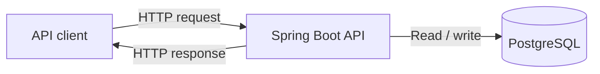

# Basic architecture

For the first version, I want to keep the application simple: one Spring Boot backend and one PostgreSQL database.

The client sends requests to the API. Spring Boot checks the input, runs the business logic, and saves or reads data in PostgreSQL.

I'm not splitting the application into microservices at the beginning. When the basic API works and has tests, I can add a message queue and a worker for background tracking updates.
