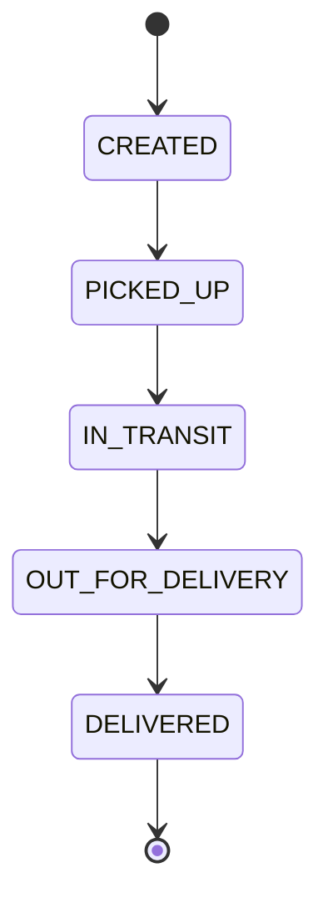

# Shipment status flow

A shipment moves through a small number of statuses. This is the first draft of the flow; I will review the rules when I build the tracking feature.

## Tracking event persistence

Shipment creation and accepted status transitions now create
records in the shipment_events table.

Each event contains its previous status, new status,
event type, sequence number, and timestamp.

The ShipmentService saves the current state and tracking
event within the same database transaction.

Sequence numbers follow shipment versions.

Existing shipments receive a BASELINE event during the
V2 migration. This is a snapshot, not reconstructed history.

The status update REST endpoint is available.

Retrieving tracking history through the API is not yet
implemented. Duplicate event detection, out-of-order
processing, and RabbitMQ integration are planned.