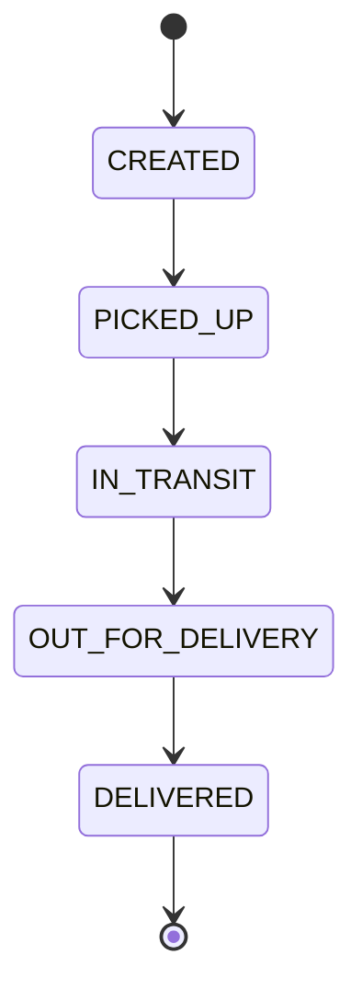

# Shipment status flow

A shipment moves through a small number of statuses. This is the first draft of the flow; I will review the rules when I build the tracking feature.

## Status transition rules

The application now enforces shipment status transitions
inside the Shipment entity.

Only the next status in the lifecycle is allowed.

For example, a shipment in CREATED can move to PICKED_UP,
but it cannot move directly to DELIVERED.

Backward transitions, repeated statuses, and changes after
DELIVERED are rejected.

These rules are implemented in ShipmentStatus and Shipment.

The Service performs status changes inside a database transaction.

The REST endpoint for changing status and the tracking event
history are not implemented yet.

Handling duplicate and out-of-order events will be added later.