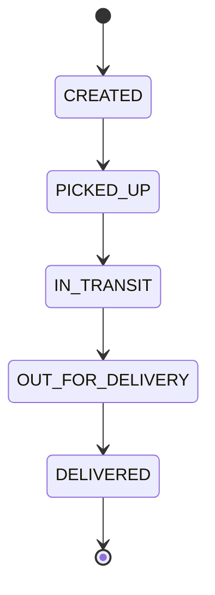

# Shipment status flow

A shipment moves through a small number of statuses. This is the first draft of the flow; I will review the rules when I build the tracking feature.

For now, I plan to allow only the next status in the flow. For example, a shipment cannot go directly from `CREATED` to `DELIVERED`.

Later I can decide how to handle cancelled shipments, failed deliveries, and events that arrive out of order.
